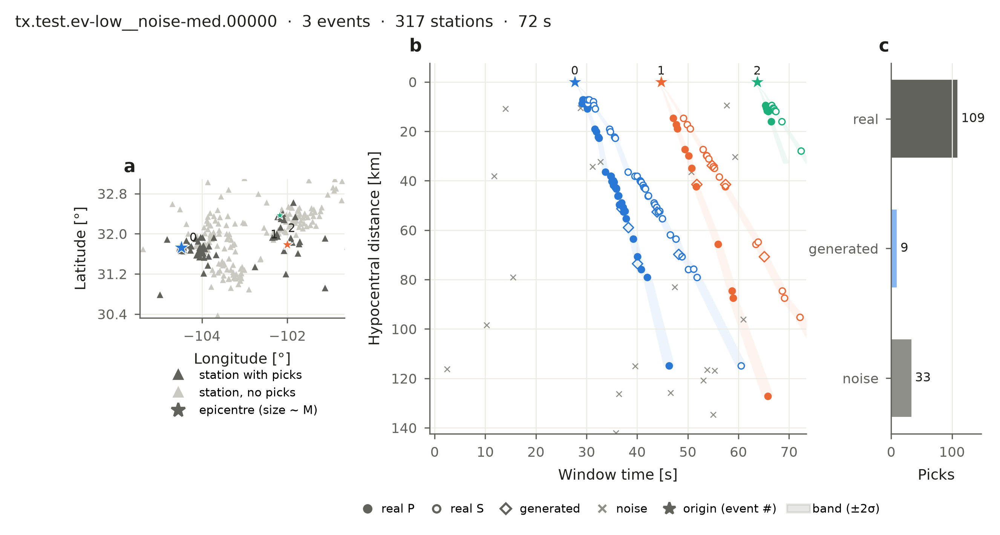

# BEPAD — a benchmark dataset for seismic phase association

[](https://pypi.org/project/bepad/) [](https://huggingface.co/datasets/ecastillot/BEPAD/tree/main/v0.1) [](https://huggingface.co/datasets/ecastillot/BEPAD) [](https://bepad.readthedocs.io/en/latest/) [](https://github.com/ecastillot/BEPAD)

A phase associator groups the P and S picks of a seismic network into earthquakes. BEPAD gives
thousands of association problems built from **real earthquakes and real picks**
([UTDQuake](https://huggingface.co/datasets/ecastillot/UTDQuake)), with the answer for every pick.



*One window (Texas network): (a) earthquakes and stations, (b) every pick at its distance from
its earthquake, (c) picks by type. The associator's job is to find which picks belong together.*

```python
import bepad

test = bepad.load("test", networks=["tx"], max_windows=20, labels=False)   # 20 Texas test windows
for w in test:                                   # one window = one association problem
    w.picks, w.stations                          # picks (station, P/S, time) and station coordinates
report = bepad.evaluate(predictions, test)       # score your associator
```

Share your associator and get on the leaderboard in four commands:

```bash
bepad new my-method                                            # template folder
bepad run associators/my-method --split test --out results/my-method
bepad submit results/my-method --code associators/my-method    # opens a Hugging Face pull request
```

| | |
|---|---|
| **What is in a window** | several overlapping earthquakes on one network, with **real**, **generated** (plausible extra arrivals) and **noise** picks; every pick labelled with its earthquake and a confidence `prob` (≥ 0.5 arrival, 0 noise) |
| **Difficulty** | 23 scenarios: 1–20 earthquakes per window × 5 noise levels, plus earthquakes outside the network |
| **Size** | per network and scenario: 1,000 train · 200 val · 100 test windows (23 scenarios) |
| **Associator authors** | fill in `bepad.Associator`, run on `test`, submit to the leaderboard — see *Contribute your associator* |
| **Deep learning** | `bepad.torch.ReleaseWindowDataset` — see *Train a model* |

Documentation: https://bepad.readthedocs.io · Data: https://huggingface.co/datasets/ecastillot/BEPAD · Code: https://github.com/ecastillot/BEPAD.
Install: `pip install bepad` (or `pip install -e .` from this folder; `.[dl]` for PyTorch, `.[build]` to rebuild the dataset).

## Repository

```
bepad/            load, evaluate, Associator, leaderboard, torch, plots  (what users need)
bepad/build/      pool, labels, windows, release (how the dataset is built)
configs/          pool.yaml (quality control, split, labels), v0.1.yaml, dev.yaml (scenarios, sizes)
docs/             Read the Docs sources; docs/gallery/ = the code of every figure
associators/      contributed associators, one folder each (pyocto = worked example)
pipeline/         the recipe of a release (SLURM): pool -> release -> baselines (pipeline/README.md)
hf/README.md      Hugging Face dataset card
```

## License and citation

Code: GPL-3.0. Data: the terms of the original providers, as in UTDQuake. Please cite UTDQuake and
the network operators of the data you use.
