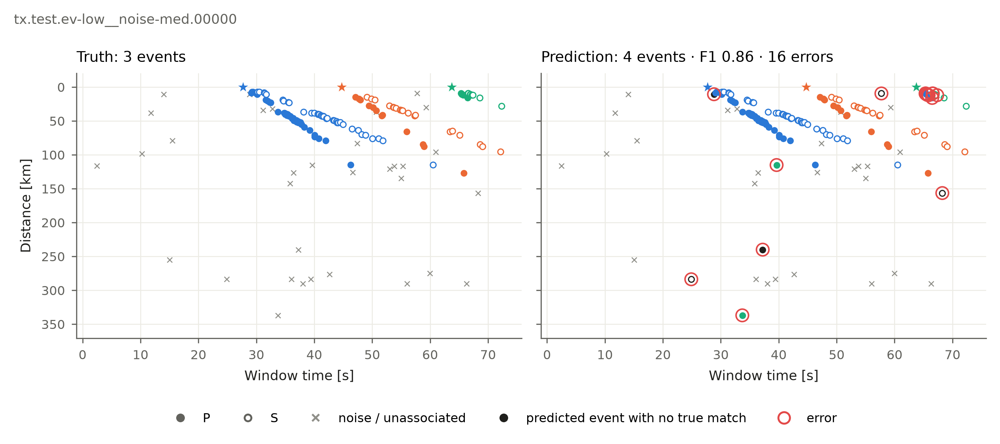
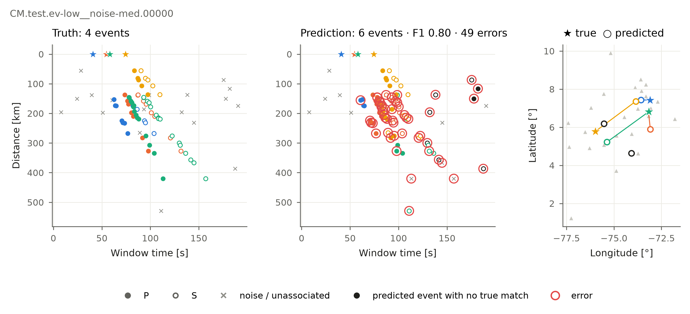

Benchmark your associator
=========================

Four rules
----------

#. Report results on the **test** split of every network you use (for the leaderboard: at least the
   10 BEPAD-10 networks).
#. Your method sees only the picks and stations of each window (never the labels).
#. Each window is a separate problem.
#. Tune settings only on **train** and **val**.

The quickest way: fill in one method
------------------------------------

Write your method as a small class. BEPAD does the loop, the timing and the scoring:

.. code-block:: python

   import numpy as np
   import bepad

   class MyMethod(bepad.Associator):
       name = "my-method"

       def associate(self, picks, stations):
           # picks:    pick_idx, station, phase ("P"/"S"), t_rel_s (s from window start), time (UTC)
           # stations: station, latitude, longitude, elevation (every station of the window)
           # return:   one integer per pick -- its earthquake number, or -1 for noise
           return np.full(len(picks), -1)

   result = MyMethod(threshold=0.3).run("test", networks=["tx"], max_windows=20)   # kwargs -> self.config
   print(result.report)            # scores
   result.report.by_scenario       # one row per scenario

For example, the simple associator of EQTransformer (``associators/eqt-utils_simple``) on 20
Texas test windows prints:

.. code-block:: text

    event_precision  event_recall  event_f1  pick_precision  pick_recall  pick_f1  noise_rejection  split_rate  merge_rate
             0.7521        0.5906    0.6617          0.1975       0.4782   0.2795              0.0      0.7718      0.5983

It finds 59 % of the earthquakes, but splits 77 % of them and merges 60 %, and it puts every noise
pick into an earthquake (noise rejection 0): fixed 15 s windows cannot separate earthquakes that
overlap. The figures below show how to see such errors window by window.

``max_windows=20`` runs 20 windows per network, for a quick try; leave it out to run every window.
Use ``run("val")`` while you tune; ``run("test")`` for the numbers you report. ``workers=16`` runs
windows on 16 CPU cores in parallel.

**If your method also locates**, return the labels and a table with one row per earthquake
number; BEPAD then reports location errors against the catalog (:doc:`reference/metrics`):

.. code-block:: python

       def associate(self, picks, stations):           # import pandas as pd
           ...
           events = pd.DataFrame({"event": [0, 1], "latitude": [...], "longitude": [...],
                                  "depth_km": [...], "t0_rel_s": [...]})     # t0 in window seconds
           return labels, events

To share the method and put it on the leaderboard: :doc:`contribute`.

See where it fails
------------------

   True grouping (left) against the associator's (right). Red circles are errors.

.. code-block:: python

   from bepad.plots import plot_prediction

   worst = result.report.per_window.sort_values("ari").window_id.iloc[0]     # the hardest window
   test = bepad.load("test", window_ids=[worst])
   plot_prediction(test[0], result.predictions, result.locations, save_path="worst_window.png")

With locations, a map is added (true epicentres ★ joined to the predicted ○):

   eqt-utils_simple on a Colombian window: it places each earthquake at its first station.

And the scores over the scenario grid:

.. code-block:: python

   from bepad.plots import plot_scores
   plot_scores(result.report.by_scenario, metric="event_f1", save_path="event_f1.png")

What the scores mean
--------------------

.. list-table::
   :header-rows: 1
   :widths: 30 70

   * - Metric
     - Question it answers
   * - Event precision / recall / F1
     - Did you find the earthquakes, without inventing extra ones?
   * - Pick precision / recall / F1
     - Did each pick go to the right earthquake?
   * - Noise rejection
     - Did you leave the false picks unassociated?
   * - Split / merge rate
     - Did you break an earthquake in two, or fuse two into one?

Definitions: :doc:`reference/metrics`.

Without the class
-----------------

If your method already has its own loop, write one row per pick (``window_id, pick_idx,
pred_event``) and score it:

.. code-block:: python

   import pandas as pd

   test = bepad.load("test", networks=["tx"], labels=False)       # the windows to score
   rows = [bepad.predictions_frame(w.window_id, w.picks.pick_idx, my_associator(w.picks, w.stations))
           for w in test]
   report = bepad.evaluate(pd.concat(rows), test)
