Figure gallery
==============

Every figure BEPAD can draw, with the code that made it. All functions are in ``bepad.plots``,
return a matplotlib figure, and save at 400 dpi with ``save_path=``.

.. contents:: On this page
   :local:
   :depth: 1

One window
----------

Anatomy of a window: ``plot_window_anatomy``
^^^^^^^^^^^^^^^^^^^^^^^^^^^^^^^^^^^^^^^^^^^^

Map, picks against time and distance, and pick counts. The first figure to look at.

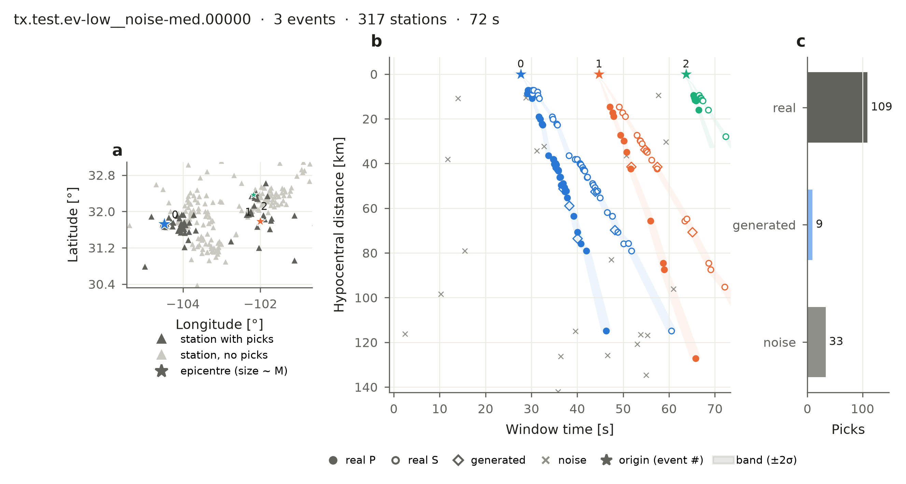

.. literalinclude:: ../gallery/window_anatomy.py

Picks against time: ``plot_window``
^^^^^^^^^^^^^^^^^^^^^^^^^^^^^^^^^^^

Every pick at its distance from its earthquake; with ``model`` the bands are shaded.

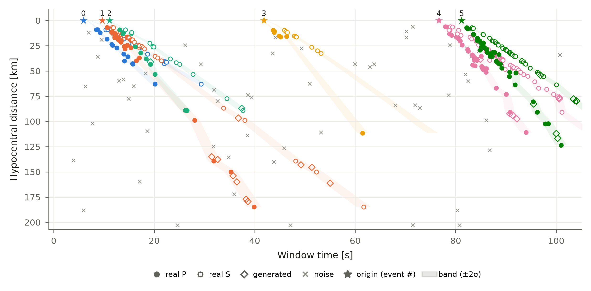

.. literalinclude:: ../gallery/window.py

Map: ``plot_window_map``
^^^^^^^^^^^^^^^^^^^^^^^^

Where the earthquakes (size ~ magnitude) and the stations of the window are.

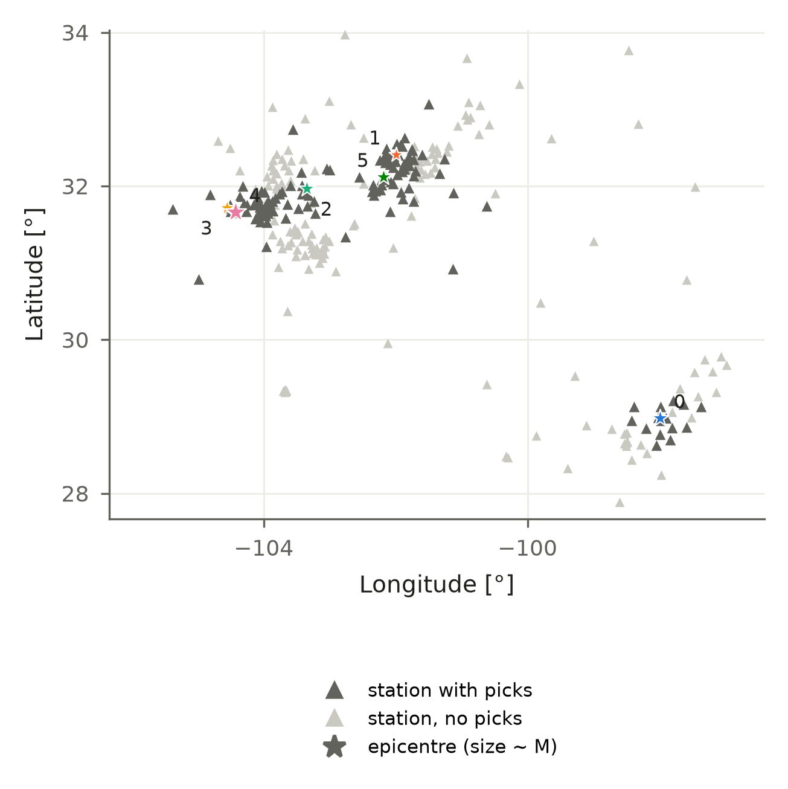

.. literalinclude:: ../gallery/window_map.py

Each earthquake and its band: ``plot_event_labels``
^^^^^^^^^^^^^^^^^^^^^^^^^^^^^^^^^^^^^^^^^^^^^^^^^^^

Travel time against distance per earthquake: predicted arrival, band, generated-pick zone, last
station; picks coloured by ``prob``.

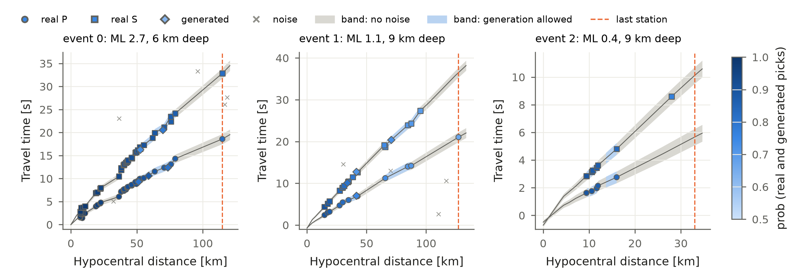

.. literalinclude:: ../gallery/event_labels.py

Your associator vs the truth: ``plot_prediction``
^^^^^^^^^^^^^^^^^^^^^^^^^^^^^^^^^^^^^^^^^^^^^^^^^

Left: the true grouping. Right: the associator's, with each predicted earthquake coloured like the
true one it matches. Red circles are errors — a pick in the wrong earthquake, noise put in an
earthquake, or a pick left out. Use it on your worst windows (``result.report.per_window``).

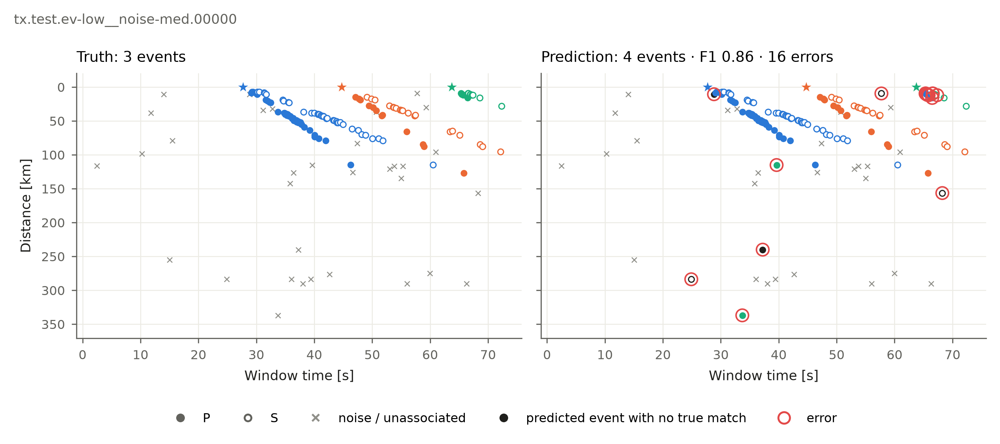

.. literalinclude:: ../gallery/prediction.py

For an associator that also locates, pass ``result.locations``: a map joins each true epicentre
(★) to its predicted location (○).

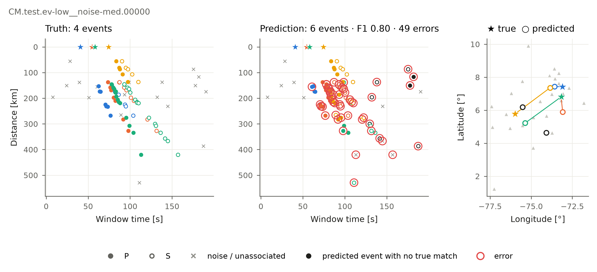

.. literalinclude:: ../gallery/prediction_locations.py

The dataset
-----------

Scenarios: ``plot_scenario_grid``
^^^^^^^^^^^^^^^^^^^^^^^^^^^^^^^^^

One window per (earthquakes per window, noise level).

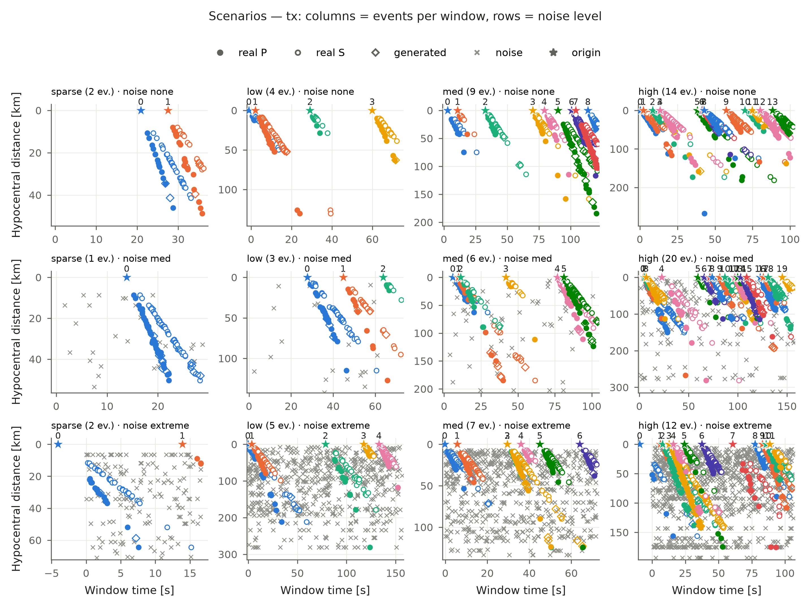

.. literalinclude:: ../gallery/scenarios.py

Earthquakes outside the network: ``plot_gap_sweep``
^^^^^^^^^^^^^^^^^^^^^^^^^^^^^^^^^^^^^^^^^^^^^^^^^^^

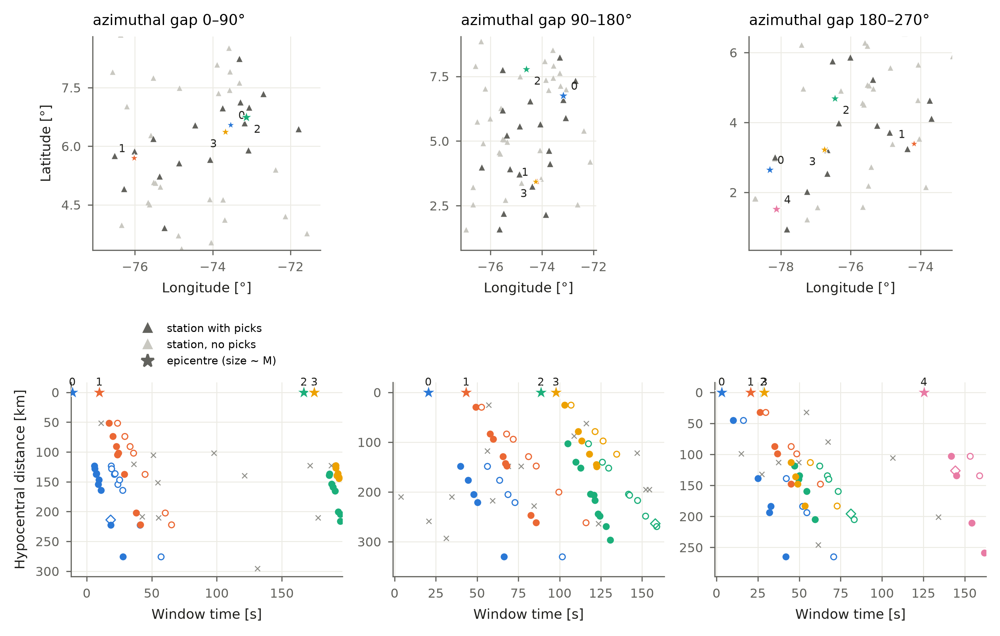

.. literalinclude:: ../gallery/gap_sweep.py

Difficulty: ``plot_difficulty``
^^^^^^^^^^^^^^^^^^^^^^^^^^^^^^^

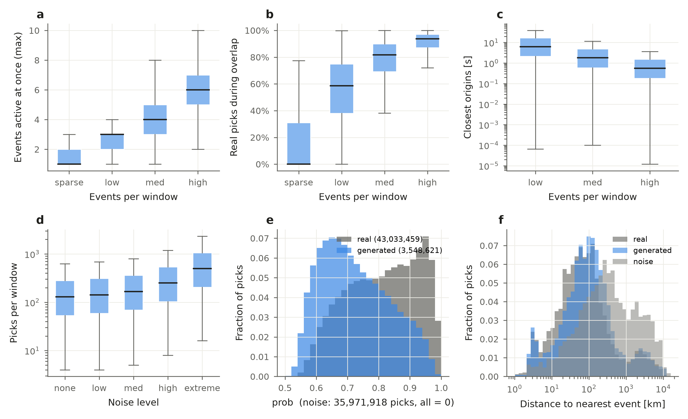

.. literalinclude:: ../gallery/difficulty.py

Statistics: ``plot_release_stats``
^^^^^^^^^^^^^^^^^^^^^^^^^^^^^^^^^^

Window length, picks per window, azimuthal gap and magnitude, per network.

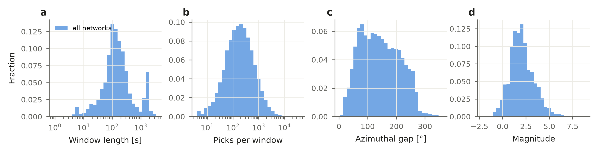

.. literalinclude:: ../gallery/release_stats.py

Labels: ``plot_label_model``
^^^^^^^^^^^^^^^^^^^^^^^^^^^^

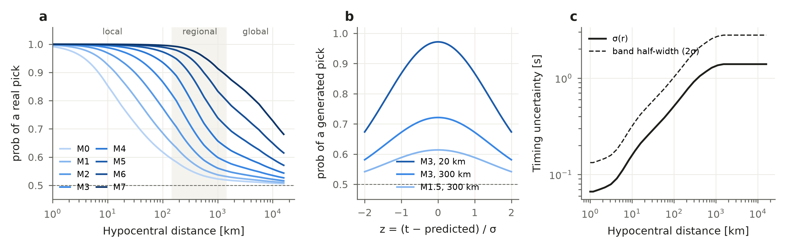

.. literalinclude:: ../gallery/label_model.py

Results
-------

Scores per scenario: ``plot_scores``
^^^^^^^^^^^^^^^^^^^^^^^^^^^^^^^^^^^^

One metric over the scenario grid; empty cells were not run.

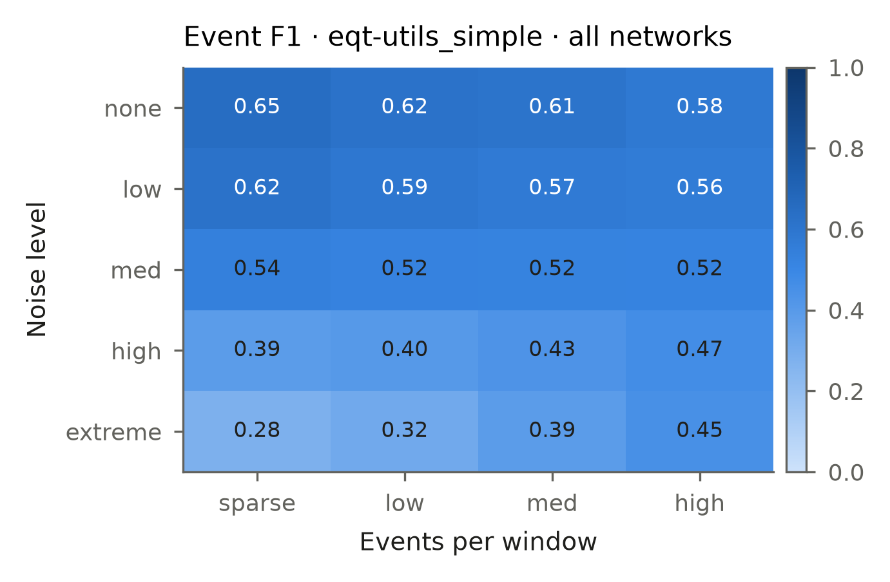

.. literalinclude:: ../gallery/scores.py
