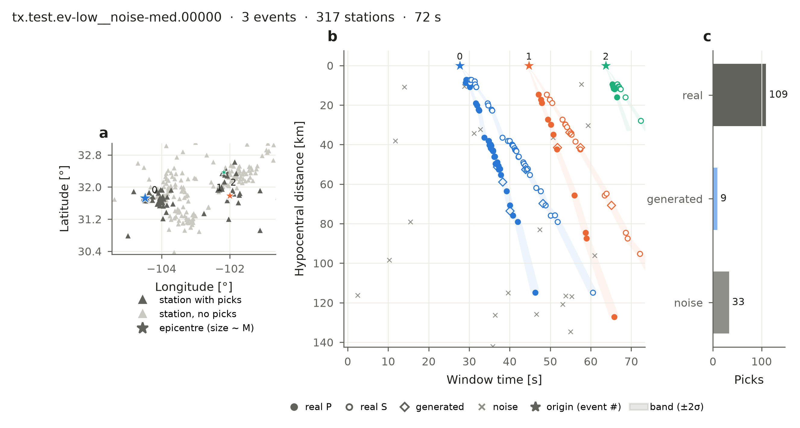

Get the data
============

BEPAD is a finished dataset on Hugging Face. You download it; you never build it.

With the ``bepad`` package
--------------------------

.. code-block:: bash

   pip install bepad

.. code-block:: python

   import bepad

   test = bepad.load("test")                          # all networks
   test = bepad.load("test", networks=["tx", "CM"])   # only some networks
   print(test)                                        # <bepad.Split 2000 windows, ...>

   w = test[0]          # one window (or: for w in test: ...)
   w.picks              # the picks of the window
   w.stations           # the stations of the window, with coordinates
   w.events             # the true earthquakes (answers)

Only the files you ask for are downloaded, and they are cached, so the second call is instant.
``bepad.load("train")`` and ``bepad.load("val")`` work the same way.

Look at a window
----------------

.. code-block:: python

   from bepad.plots import plot_window_anatomy

   plot_window_anatomy(test[0], model=test.release.label_model, save_path="window.png")

What the panels and labels mean: :doc:`window`. More figures, each with its code:
:doc:`figures`.

Without installing anything
---------------------------

Every table is a plain Parquet file:

.. code-block:: python

   import pandas as pd

   base = "hf://datasets/ecastillot/BEPAD/v0.1"
   picks = pd.read_parquet(f"{base}/test/picks/network=tx.parquet")
   windows = pd.read_csv(f"{base}/metadata/windows_test.csv")

How much data
-------------

Every network has the same number of windows in each of the 23 scenarios. BEPAD v0.1 has 91
networks:

.. list-table::
   :header-rows: 1

   * - Split
     - Per network and scenario
     - Per network (× 23 scenarios)
     - All networks
     - Use
   * - ``train``
     - 1,000
     - 23,000
     - 2,068,000 (90 networks)
     - training models
   * - ``val``
     - 200
     - 4,600
     - 412,800 (90 networks)
     - tuning settings
   * - ``test``
     - 100
     - 2,300
     - 208,900 (91 networks)
     - reporting results
   * - **total**
     - 1,300
     - 29,900
     - **2,689,700**
     -

Networks with fewer than 200 earthquakes are test only (in v0.1: ESPOO, ``R06``), so train and val
have 90 networks. A few networks cannot make every gap scenario (no earthquakes with that gap) and
have fewer windows; the exact counts are in ``manifest.json`` and ``metadata/networks.csv``.

Each earthquake belongs to exactly one split (70 / 10 / 20 % of the earthquakes of each network,
chosen at random).
