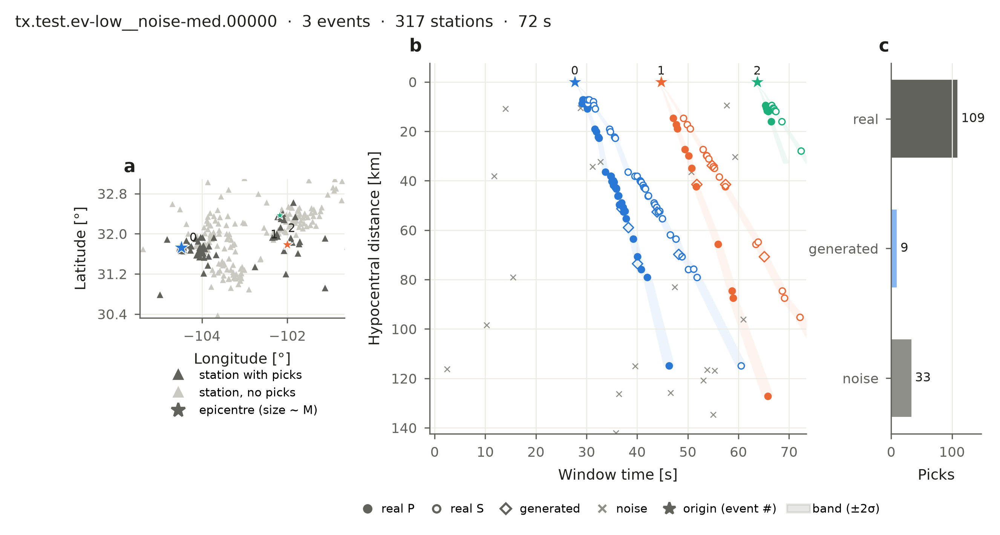

BEPAD
=====

.. image:: https://img.shields.io/pypi/v/bepad?color=orange&label=PyPI&style=for-the-badge&logo=pypi&logoColor=white
   :target: https://pypi.org/project/bepad/
   :alt: PyPI version
.. image:: https://img.shields.io/badge/Data-v0.1-yellow?style=for-the-badge
   :target: https://huggingface.co/datasets/ecastillot/BEPAD/tree/main/v0.1
   :alt: Data v0.1
.. image:: https://img.shields.io/badge/HuggingFace-Dataset-yellow?style=for-the-badge&logo=huggingface&logoColor=black
   :target: https://huggingface.co/datasets/ecastillot/BEPAD
   :alt: Hugging Face dataset
.. image:: https://img.shields.io/badge/GitHub-BEPAD-black?style=for-the-badge&logo=github
   :target: https://github.com/ecastillot/BEPAD
   :alt: GitHub repository

**Benchmark Earthquake Phase Association Dataset**

A phase associator takes the P and S picks of a seismic network and groups them into earthquakes.
BEPAD gives you thousands of association problems built from **real earthquakes and real picks**
(`UTDQuake <https://huggingface.co/datasets/ecastillot/UTDQuake>`_), with the answer for every pick.

   One BEPAD window (Texas network). (a) Where the earthquakes and stations are. (b) Every pick in
   the window, at its distance from its earthquake. The associator's job is to find which picks
   belong together. (c) Picks by type.

.. code-block:: python

   import bepad

   test = bepad.load("test", networks=["tx"], max_windows=20, labels=False)   # 20 Texas test windows
   for w in test:                              # one window = one association problem
       w.picks                                 # station, phase (P/S), time
       w.stations                              # station coordinates

Start here
----------

.. list-table::
   :widths: 35 65

   * - :doc:`get_data`
     - Download BEPAD and load it (one line).
   * - :doc:`window`
     - What is inside a window, and what every label means.
   * - :doc:`scenarios`
     - How difficulty is controlled, with figures.
   * - :doc:`benchmark`
     - **Associator authors:** test your method and see where it fails.
   * - :doc:`contribute`
     - Share your associator and get on the :doc:`leaderboard` (four commands).
   * - :doc:`train`
     - **Deep learning:** train a model on BEPAD.
   * - :doc:`figures`
     - Every figure BEPAD can draw, with its code.

.. toctree::
   :hidden:
   :caption: Get started

   get_data
   window
   scenarios

.. toctree::
   :hidden:
   :caption: Associators

   benchmark
   associators
   contribute
   leaderboard

.. toctree::
   :hidden:
   :caption: Deep learning

   train

.. toctree::
   :hidden:
   :caption: Figures

   figures

.. toctree::
   :hidden:
   :caption: Dataset details

   reference/statistics
   reference/structure
   reference/format
   reference/labels
   reference/metrics

.. toctree::
   :hidden:
   :caption: For maintainers

   reference/building

.. toctree::
   :hidden:
   :caption: About

   reference/api
   changelog
   citation
