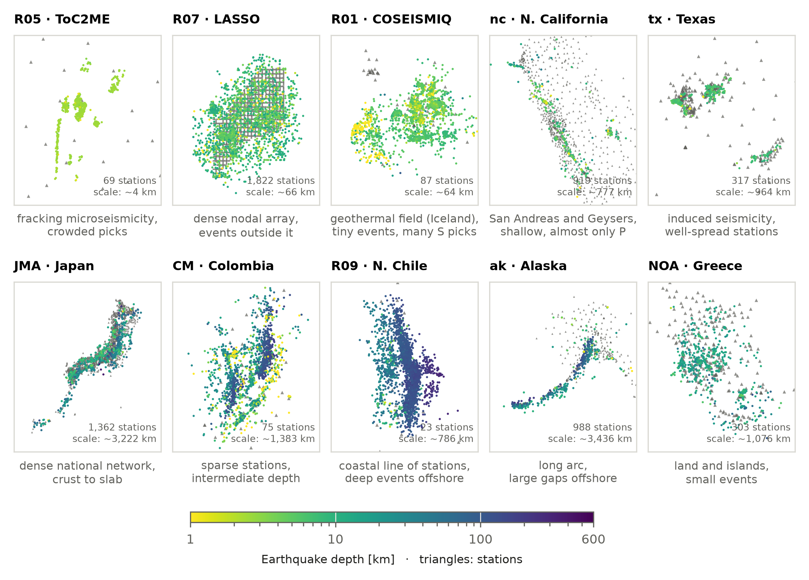

Leaderboard
===========

Results of associators on the BEPAD **test** split, ranked by event F1. Every entry was re-checked
from its submitted predictions. To add yours: :doc:`contribute`.

By default the table shows the **BEPAD-10 test**: the test windows of 10 networks that every entry
must run, chosen to cover different scales, geometries and depths. Each method's score is the mean over these networks
(each network weighs the same). Use the *Networks* menu to see the mean over all networks, or one
network with every associator that ran it.

.. list-table::
   :widths: 25 75

   * - **Type**
     - classical, deep learning or hybrid
   * - **Training**
     - none, per network (a model per network) or all networks (one model)
   * - **Partial**
     - did not run every window of the network; listed, not ranked
   * - **Location errors**
     - median over matched earthquakes, against the catalog; – = the method does not locate
   * - **s/window**
     - time spent inside the associator per window, on the author's hardware

**Before posting**, authors see their row in these tables with ``bepad submit ... --dry-run``.
The official tables are also in the dataset repository (``leaderboard/README.md`` on Hugging
Face).

The BEPAD-10 test
-----------------

The 10 networks of the main ranking. Each one brings a different difficulty; together they go from
a 4 km fracking array to a 3,000 km national network. Global networks (``ISC``, ``R08`` ...) are in
BEPAD too, with their own tables, but not in BEPAD-10.

   Stations (triangles) and test earthquakes (coloured by depth) of each core network.

.. list-table::
   :header-rows: 1
   :widths: 18 18 64

   * - Network
     - Scale
     - The challenge
   * - ``R05`` ToC2ME
     - 4 km
     - Microseismicity from hydraulic fracturing: many tiny earthquakes, picks very close in time.
   * - ``R07`` LASSO
     - 60 km
     - 1,822 stations 0.4 km apart; many earthquakes outside the array.
   * - ``R01`` COSEISMIQ
     - 90 km
     - Hengill geothermal area, Iceland (ISOR): 87 stations, very small shallow earthquakes, many S
       picks.
   * - ``nc`` N. California
     - local
     - San Andreas faults and The Geysers: very shallow, almost only P picks. A classic test network.
   * - ``tx`` Texas
     - local
     - Induced seismicity with well-spread stations: the "standard" case.
   * - ``JMA`` Japan
     - national
     - Dense network; earthquakes from the crust down to the subducting slab.
   * - ``CM`` Colombia
     - regional
     - Few stations, 60 km apart; most earthquakes at intermediate depth (> 70 km).
   * - ``R09`` N. Chile (IPOC)
     - regional
     - 23 stations along the coast; deep earthquakes, mostly offshore (large gaps).
   * - ``ak`` Alaska
     - regional
     - A long arc: most earthquakes are offshore, with large azimuthal gaps.
   * - ``NOA`` Greece
     - regional
     - Stations on land and islands; many small earthquakes.

Run them with one command, which writes your predictions, scores and leaderboard row
(:doc:`contribute`):

.. code-block:: bash

   bepad run associators/my-method --split test --networks core --out results/my-method
   bepad submit results/my-method --code associators/my-method --dry-run

More about each catalog: `UTDQuake <https://utdquake.readthedocs.io>`_.

.. literalinclude:: ../gallery/core_networks.py
   :caption: Code for this figure

Official results
----------------

.. raw:: html
   :file: _generated/leaderboard.html

Preview: how the leaderboard will look
--------------------------------------

.. warning::

   **Example only — not official results.** BEPAD v0.1 is not published yet. The tables below were
   built from the small development release (six networks, 5 test windows per scenario) with
   one of the :doc:`associators`, using the same commands authors will use. Here the six
   development networks stand in for the core networks.

.. raw:: html
   :file: _generated/leaderboard_example.html
