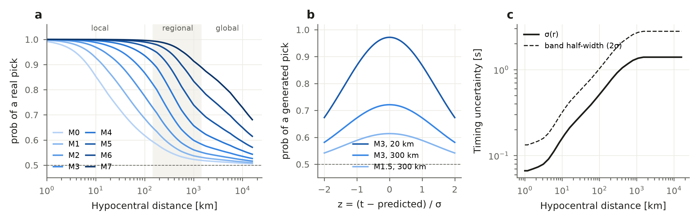

Labels and generated picks
==========================

The label model is fitted once on all networks of the pool and shipped as ``label_model.json``
(``bepad.load(...).release.label_model`` in Python). The same curves apply to every network.

   (a) ``prob`` of a real pick against distance, per magnitude. (b) ``prob`` of a generated pick
   against its offset from the predicted time. (c) Timing uncertainty σ(r) and the band half-width.

.. literalinclude:: ../../gallery/label_model.py
   :caption: Code for this figure

Formulas
--------

``prob`` does not change the label (``event_idx``); it is a confidence for training, built from
the detectability q(M, r).

.. code-block:: text

   q(M, r)   = sigmoid( (M − B(r)) / w )             detectability of magnitude M at distance r
   real      prob = 0.5 + 0.5 · q(M, r)^0.5
   generated prob = 0.5 + 0.5 · ( q(M, r) · exp(−z²/2) )^0.5,   z = (t − predicted) / σ(r)
   noise     prob = 0

* ``r`` is the hypocentral distance. ``B(r)``, the smallest magnitude usually recorded at
  distance r, is smooth and increasing, fitted on which stations did and did not pick each
  earthquake.
* ``σ(r)`` never decreases with distance. It is fitted by predicting each real pick from its
  neighbours on the same earthquake.

Predicted arrival of an earthquake
----------------------------------

* Between its first and last real pick of a phase: interpolation of its own picks.
* Elsewhere: the network travel-time curve, shifted to join its own picks. The network S curve
  is the P curve × the network S/P ratio.
* No S picks: its own P prediction × the network S/P ratio.

Placement rules
---------------

* **Band** = predicted arrival ± 2σ(r), for P and S.
* **Noise**: 90 % at a distance drawn uniformly up to the farthest real pick of the window, 10 %
  on any station; uniform in time; rejected if inside any earthquake's band.
* **Generated picks**: (0–0.2) × the number of real picks, drawn per window. They go at stations
  without a real pick of that earthquake and phase, at the predicted time + z·σ with
  \|z\| ≤ 2, only between the earthquake's first and last real station, and only where its real
  picks are at most 30 % of the distance apart.
* Two picks on the same station and phase within 0.5 s become one (real > generated > noise).
