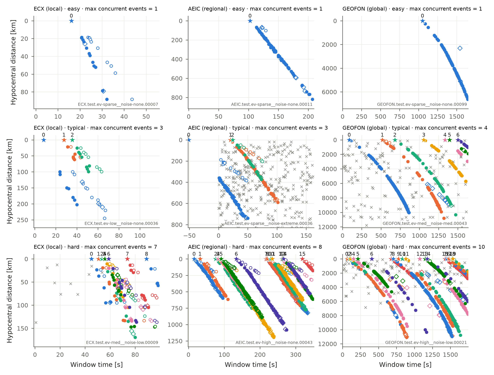
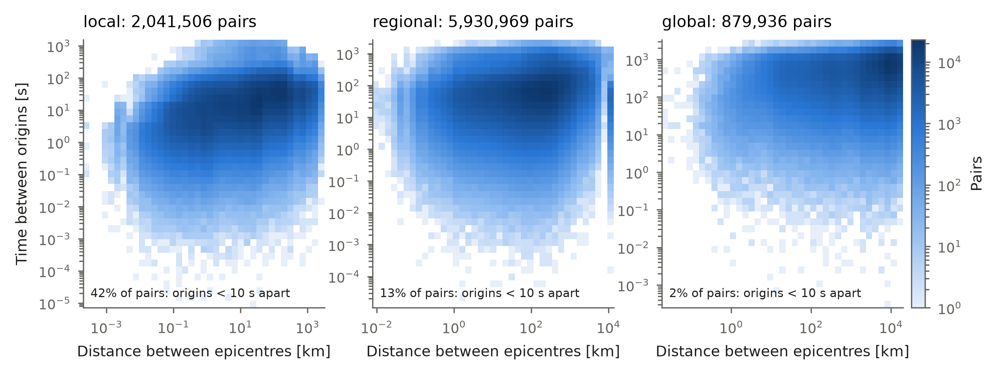
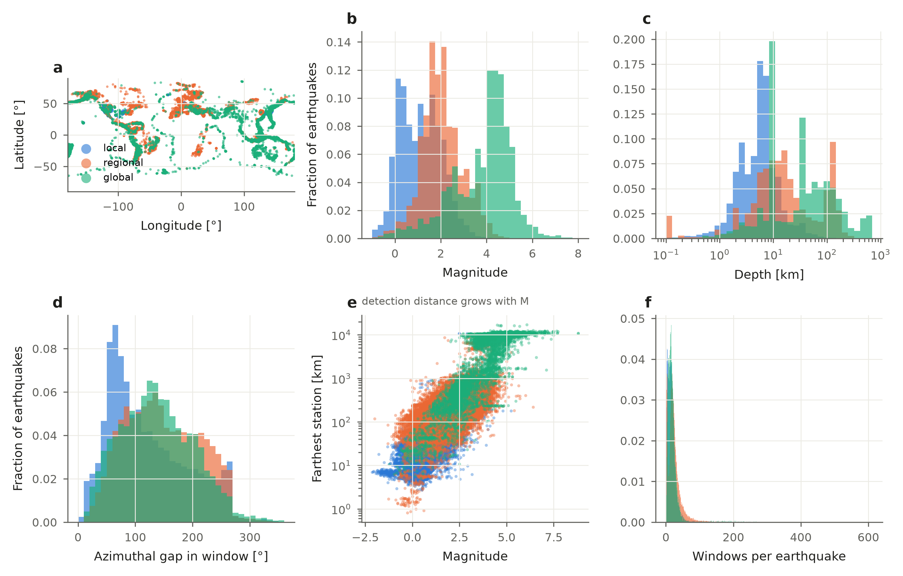
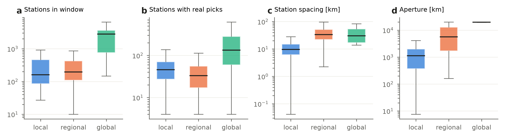
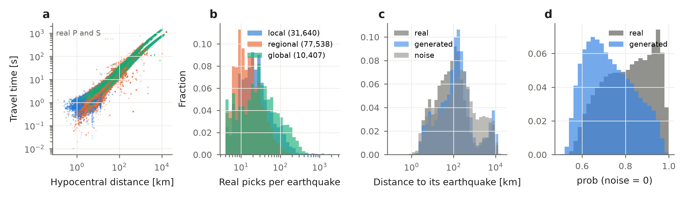

Dataset statistics
==================

What is inside BEPAD v0.1: how many windows and picks, what the windows look like, and the
earthquakes, stations and picks they are made of. Every figure is drawn from the release tables
(``bepad.stats`` computes the tables, ``bepad.plots`` draws them), so it describes exactly the
earthquakes and picks that BEPAD contains. Statistics of the full source catalogs, before BEPAD's
selection, are in the `UTDQuake documentation <https://utdquake.readthedocs.io>`_.

Data
----

Every network has the same number of windows in each of the 23 scenarios. BEPAD v0.1 has 91
networks:

.. list-table::
   :header-rows: 1

   * - Split
     - Windows per network and scenario
     - Windows per network (× 23 scenarios)
     - Windows, all networks
     - Picks, all networks
     - Use
   * - ``train``
     - 1,000
     - 23,000
     - 2,068,000 (90 networks)
     - 793 million
     - training models
   * - ``val``
     - 200
     - 4,600
     - 412,800 (90 networks)
     - 161 million
     - tuning settings
   * - ``test``
     - 100
     - 2,300
     - 208,900 (91 networks)
     - 83 million
     - reporting results
   * - **total**
     - 1,300
     - 29,900
     - **2,689,700**
     - **1,036 million**
     -

Networks with fewer than 200 earthquakes are test only (in v0.1: ESPOO, ``R06``), so train and val
have 90 networks. A few networks cannot make every gap scenario (no earthquakes with that gap) and
have fewer windows; the exact counts are in ``manifest.json`` and ``metadata/networks.csv``.

Each earthquake belongs to exactly one split (70 / 10 / 20 % of the earthquakes of each network,
chosen at random).

Picks count real, generated and noise picks. About 34 GB in all (Parquet; train 26 GB). You never
need all of it at once: :doc:`../get_data` shows how to download and load only some networks or
windows.

Representative windows
----------------------

   An easy, a typical and a hard window (10th, 50th and 90th percentile of the number of
   earthquakes active at once) for a local, a regional and a global network (most picks within
   150 km, 1,500 km, or farther).

.. literalinclude:: ../../gallery/stats_representative_windows.py

Earthquakes close in space and time
-----------------------------------

   Every pair of earthquakes in the same window: distance between epicentres against time between
   origins. Pairs close in both (lower left) are the hardest to associate: their picks reach the
   same stations at the same time.

.. literalinclude:: ../../gallery/stats_event_proximity.py

The tables
----------

The numbers behind the figures. Each function of ``bepad.stats`` takes a loaded split (with
labels) and returns a pandas table, so you can make your own statistics or plots:

.. code-block:: python

   import bepad
   from bepad import stats

   test = bepad.load("test", networks=["tx", "CM"])
   stats.event_pairs(test)        # one row per pair of earthquakes in a window

.. code-block:: text

                                 window_id network                scenario  distance_km   dt_s     scale
      CM.test.ev-high__noise-extreme.00000      CM  ev-high__noise-extreme        390.5   24.3  regional
      CM.test.ev-high__noise-extreme.00000      CM  ev-high__noise-extreme         47.0   27.8  regional
      CM.test.ev-high__noise-extreme.00000      CM  ev-high__noise-extreme         46.5   69.1  regional

Each row is two earthquakes of the same window: how far apart (``distance_km``) and how close in
time (``dt_s``) — the table behind the figure *Earthquakes close in space and time*. The others:

.. list-table::
   :header-rows: 1
   :widths: 30 35 35

   * - Function
     - One row per
     - Columns (some)
   * - ``stats.source_events``
     - earthquake
     - location, depth, magnitude, farthest station, gap, number of windows it is in
   * - ``stats.event_pairs``
     - pair of earthquakes in a window
     - distance, time between origins
   * - ``stats.window_geometry``
     - window (a sample per network)
     - stations, stations that picked, spacing, aperture
   * - ``stats.pick_distances``
     - pick (of a sample of windows)
     - type, phase, distance to its earthquake, travel time, ``prob``
   * - ``stats.network_scales``
     - network
     - local / regional / global

Earthquake data
---------------

The earthquakes, stations and picks the windows are made of. The figures colour networks by
**scale**, from the 90th percentile of the distance of their real picks:
**local** (< 150 km), **regional** (150–1,500 km) and **global** (> 1,500 km).

Earthquakes
~~~~~~~~~~~

   The source earthquakes. (a) Epicentres. (b) Magnitude and (c) depth. (d) Azimuthal gap of the
   stations that picked them in the window. (e) Farthest station against magnitude: larger
   earthquakes are recorded farther away — the limit BEPAD respects when generating picks.
   (f) Number of windows each earthquake appears in.

.. literalinclude:: ../../gallery/stats_events_overview.py

Stations
~~~~~~~~

   Per window: (a) stations available, (b) stations with real picks, (c) median distance between
   neighbouring stations, (d) aperture (widest distance between two stations).

.. literalinclude:: ../../gallery/stats_station_geometry.py

Picks
~~~~~

   (a) Travel time against distance of the real P and S picks. (b) Real picks per earthquake.
   (c) Distance from each pick to its earthquake (noise: to the nearest one) — noise is spread over
   the same distances as real picks. (d) ``prob`` of real and generated picks (noise is 0).

.. literalinclude:: ../../gallery/stats_picks_overview.py
