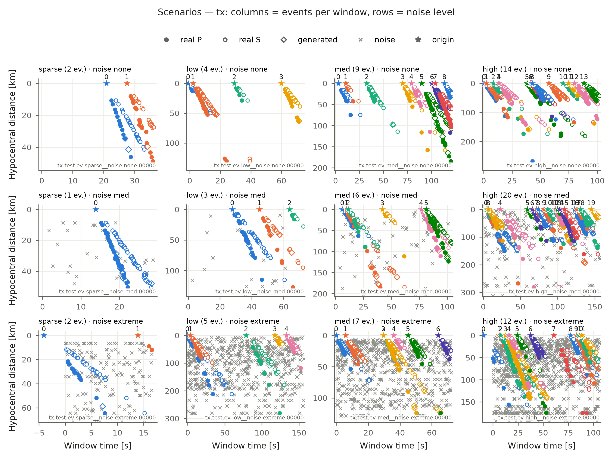
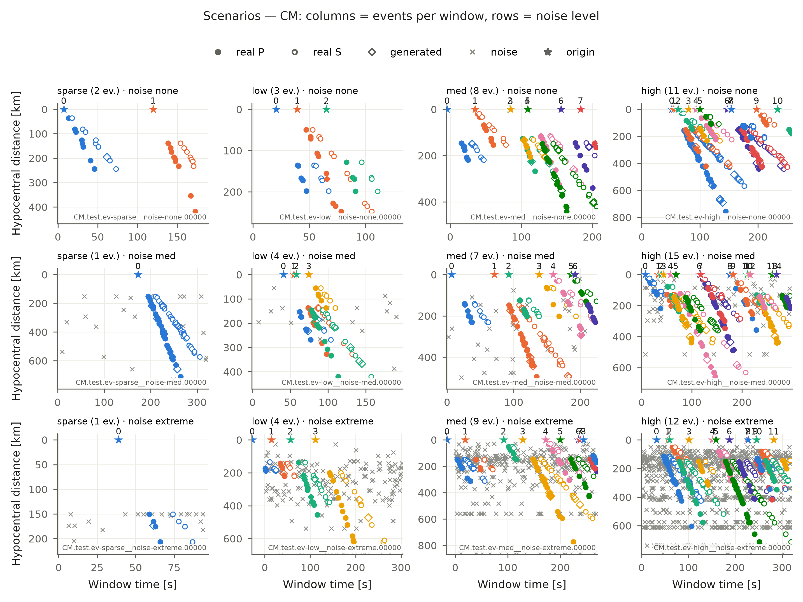
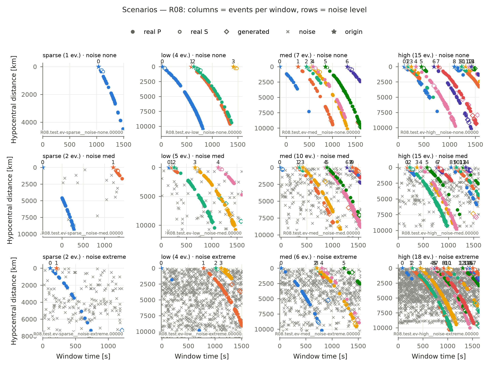
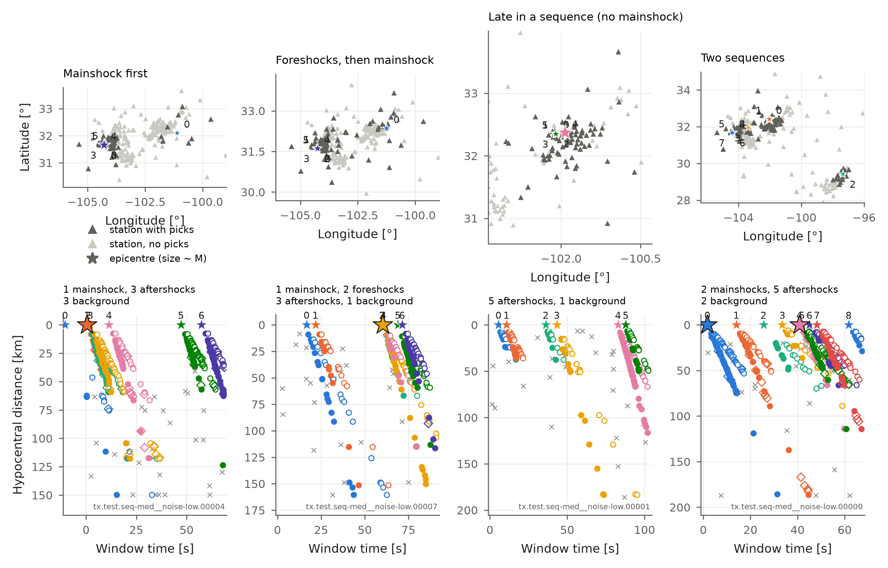
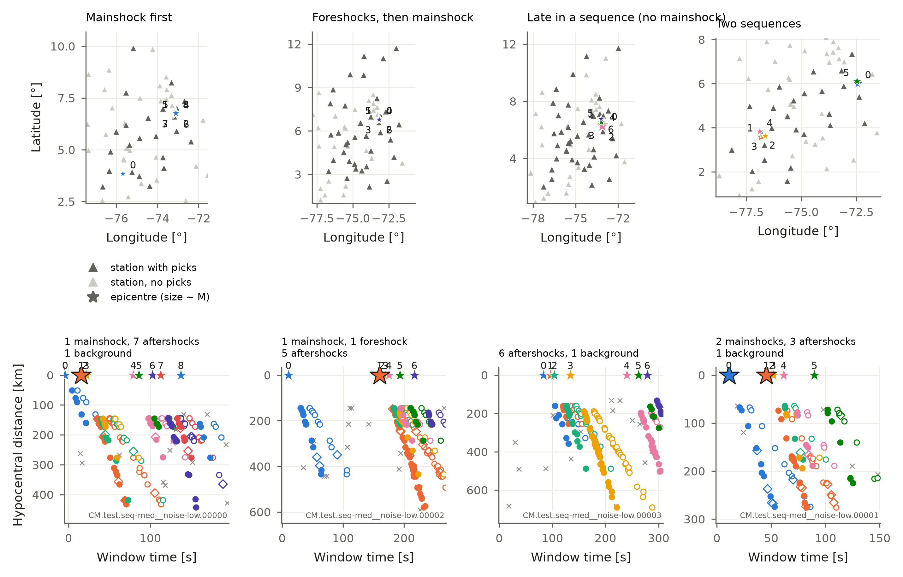
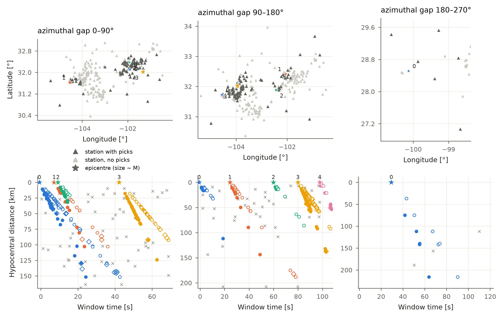
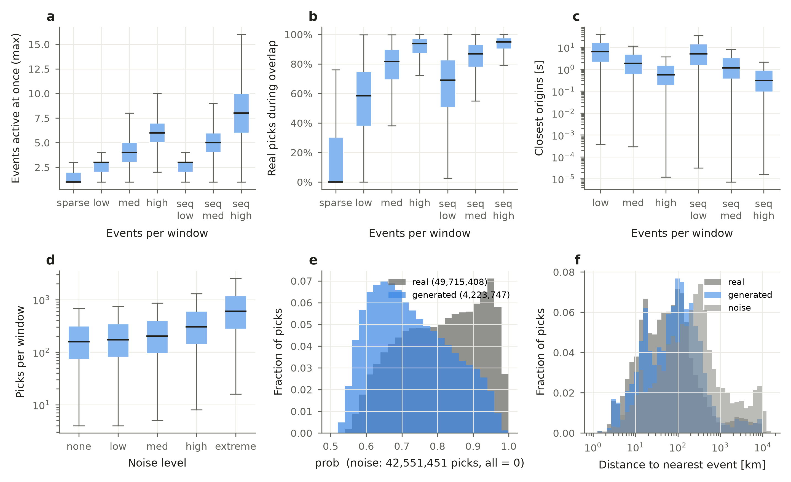
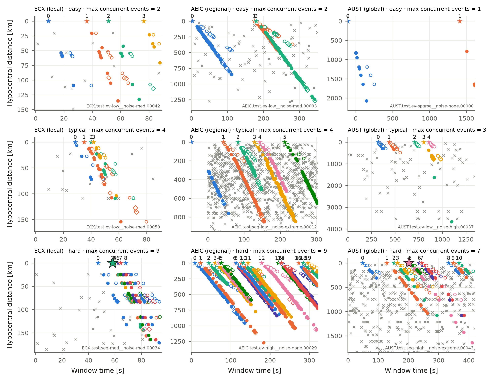

Scenarios
=========

Windows come in **38 scenarios**, so you can see where a method breaks. Each scenario answers
three questions:

* **Which earthquakes:** at random, a **sequence** (aftershocks, foreshocks: close in space and
  time) or **outside the network** (large azimuthal gap).
* **How many** in a window: sparse 1–2, low 3–5, med 6–10, high 11–20.
* **How much noise**, in noise picks per real pick: none 0, low 0.1, med 0.3, high 1, extreme 3.

.. list-table::
   :header-rows: 1
   :widths: 30 22 18 12 18

   * - Which earthquakes
     - How many
     - Noise
     - Scenarios
     - Name, e.g.
   * - **Random**: anywhere, any time
     - sparse, low, med, high
     - all 5 levels
     - 4 × 5 = 20
     - ``ev-med__noise-high``
   * - **Sequence**: aftershocks, foreshocks
     - low, med, high
     - all 5 levels
     - 3 × 5 = 15
     - ``seq-med__noise-high``
   * - **Outside the network**: gap 0–90°, 90–180°, 180–270°
     - low
     - med
     - 3
     - ``gap-090-180``
   * -
     -
     -
     - **38**
     -

**Every scenario has the same number of windows:** 600 train, 120 val and 60 test per network.
The three answers are columns of the windows table (``selection``, ``n_events_level``,
``noise_level``), so you can choose windows without reading names:

.. code-block:: python

   import bepad

   rel = bepad.open(bepad.download(splits=()))          # small files only
   w = rel.table("test", "windows", networks=["tx"])
   seq = w[(w.selection == "sequence") & (w.noise_level == "none")]
   test = bepad.load("test", window_ids=list(seq.window_id[:20]))

Random earthquakes
------------------

The earthquakes of a window are drawn at random from one network, within a year of each other
(so the same stations existed), and placed at random times in the window.

   Local network (Texas). Left to right: more earthquakes at once. Top to bottom: more noise.
   Each panel shows its ``window_id`` (bottom right): load it again with
   ``bepad.load("test", window_ids=[...])``.

   Regional network (Colombia).

   Global network. Windows last tens of minutes and distances reach 10,000 km.

.. literalinclude:: ../gallery/scenarios.py
   :caption: Code for these figures

Sequences
---------

Earthquakes close in space and time, as after a large earthquake or in a swarm: the hardest case
for association, because their picks arrive together at the same stations.

A **sequence** is an earthquake and its nearest earthquakes in 3D (same network and split, within
a year). Each window has one of four types, drawn at random:

.. list-table::
   :header-rows: 1
   :widths: 25 75

   * - Type
     - In the window
   * - **Mainshock first**
     - The mainshock early in the window, then its aftershocks.
   * - **Foreshocks**
     - A few foreshocks, more and more frequent, the mainshock in the middle, then aftershocks.
   * - **Late in a sequence**
     - Aftershocks only: the mainshock was long before the window (1–100 window lengths).
   * - **Two sequences**
     - A first mainshock early with its aftershocks, a second mainshock later in another place
       (farther than twice the size of the first sequence) with its own aftershocks.

The rules, the same for every network:

* The **mainshock** is among the largest 25 % of the network's earthquakes and larger than every
  earthquake of its sequence. Size is the magnitude; in a network without usable magnitudes
  (fewer than half the earthquakes with one, or fewer than 5 distinct values, e.g. R07), it is the
  number of stations that recorded the earthquake.
* **Timing**: after a mainshock the rate of aftershocks decays as 1 / (t + c), with c = 5 % of the
  window (Omori's law); foreshocks follow the same law backwards, towards the mainshock.
* 0–2 **background** earthquakes (independent, at random times) are added, so not every
  earthquake belongs to the sequence.
* A window that a network cannot make (not enough nearby earthquakes) is left out, as in every
  scenario.

How tight a sequence is depends on the catalog: within a few kilometres in dense local and
microseismic networks (e.g. tx, CM, R05), tens to hundreds of kilometres in global catalogs. The
windows table gives ``sequence_radius_km`` (distance from the mainshock to its farthest
earthquake) to choose tight sequences; the events table gives each earthquake's ``sequence`` and
``role`` (mainshock, foreshock, aftershock, background).

   Texas, one window of each type (6–10 earthquakes, little noise). Large stars: mainshocks.
   Each panel shows its ``window_id``.

   Regional network (Colombia).

.. literalinclude:: ../gallery/sequences.py
   :caption: Code for these figures

Earthquakes outside the network
-------------------------------

Three more scenarios select earthquakes by their **azimuthal gap**, the largest angle around the
epicentre without a station. A large gap means the earthquake is at the edge of the network or
outside it, which is harder to associate.

   Gap 0–90°, 90–180° and 180–270° (3–5 earthquakes, noise 0.3). Networks with few far-away
   earthquakes may have fewer earthquakes per window in the 180–270° scenario.
   The ``window_id`` of each window is at the bottom right of its panel.

.. literalinclude:: ../gallery/gap_sweep.py
   :caption: Code for this figure

How hard is it?
---------------

   Test split; "seq" are the sequence scenarios. (a) Earthquakes active at the same time. (b) Share of real picks that arrive while
   another earthquake is also active. (c) Time between the two closest origins. (d) Picks per
   window by noise level. (e) ``prob`` of real and generated picks. (f) Distance from each pick to
   the nearest earthquake: noise is found at the same distances as real picks.

.. literalinclude:: ../gallery/difficulty.py
   :caption: Code for this figure

What easy and hard look like:

   An easy, a typical and a hard window (10th, 50th and 90th percentile of the number of
   earthquakes active at once) for a local, a regional and a global network. Each panel shows its
   ``window_id``.

.. literalinclude:: ../gallery/stats_representative_windows.py
   :caption: Code for this figure

Statistics of the earthquakes, stations and picks: :doc:`reference/statistics`.

More figures, each with its code: :doc:`figures`.
