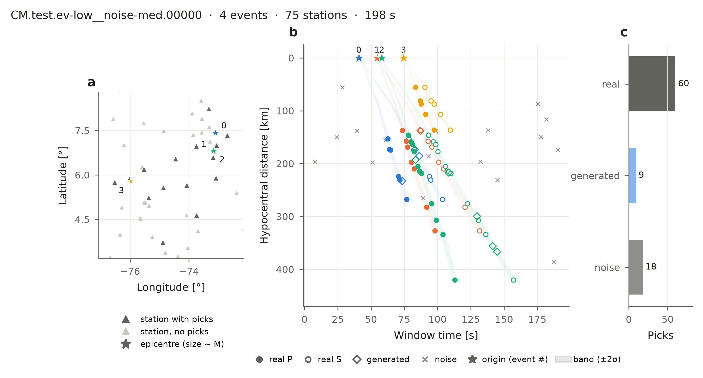
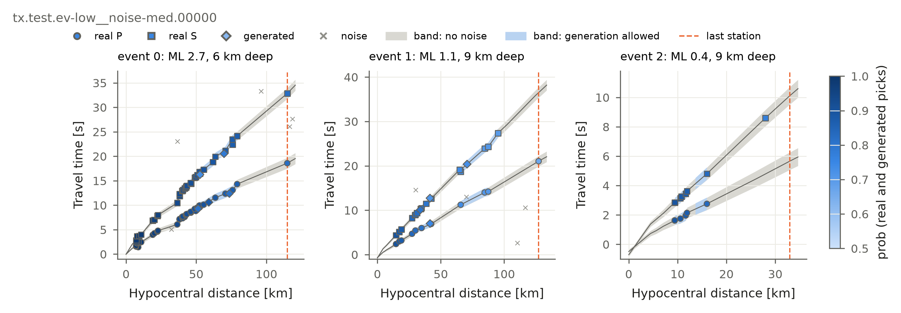

Understand a window
===================

A **window** is a stretch of time on one seismic network, containing several earthquakes whose
picks overlap in time. It is one association problem.

   A window on the Colombian network (CM). Stars are earthquake origins, numbered by origin time.
   An earthquake can start before the window (an *edge event*): then only its late picks are visible.

.. literalinclude:: ../gallery/window_anatomy_cm.py
   :caption: Code for this figure

Three kinds of picks
--------------------

.. list-table::
   :header-rows: 1
   :widths: 15 45 20 20

   * - Type
     - What it is
     - ``event_idx``
     - ``prob``
   * - **real**
     - A pick of the network, from UTDQuake, at its real travel time.
     - its earthquake
     - 0.5 – 1
   * - **generated**
     - An artificial pick placed where the earthquake's arrival is expected, at a station that did
       not pick it. It adds realistic extra picks.
     - its earthquake
     - 0.5 – 1
   * - **noise**
     - A false pick. It is never placed where an earthquake's arrival is expected.
     - −1
     - 0

**The label is** ``event_idx``: the earthquake the pick belongs to (0, 1, 2 … in order of origin
time), or −1 for noise. It is exact, and it is what the benchmark scores.

``prob`` is an extra, for training only: how confident you can be in the pick, based on how
detectable its earthquake is at that station (:doc:`reference/labels`). A pick of a large, nearby
earthquake has 1.0; a pick of a small, distant one approaches 0.5. Noise is 0. The column ``real``
(1 / 0) tells real picks from generated ones.

Where picks can go
------------------

For every earthquake BEPAD predicts when P and S should arrive at each distance, with an
uncertainty that grows with distance. The **band** is the prediction ± 2σ.

   Each panel is one earthquake of a Texas window: travel time against distance. Grey: its band,
   where noise is not allowed. Blue: the part of the band where generated picks may be placed —
   only up to its last real station and where its real picks are close together. Picks are
   coloured by ``prob``.

.. literalinclude:: ../gallery/event_labels.py
   :caption: Code for this figure

The rules:

* **Noise** is spread over all distances and times, but never inside any earthquake's band.
* **Generated picks** go only inside a band, and never beyond the earthquake's farthest real
  station. A small earthquake is not given picks where it could not be recorded.
* On average there is 1 generated pick per 10 real picks (between 0 and 2 per 10, varying per
  window).

Details and formulas: :doc:`reference/labels`.

How long is a window
--------------------

A window lasts twice the longest travel time of its earthquakes (the time from an origin to its
last real pick), so a window on a large network is longer than one on a small array. Origins are
placed at random in the window; if an earthquake starts late, the window is extended until it has
its minimum picks. How close in time the earthquakes are depends on how many the window has (the
scenario, :doc:`scenarios`).

Every earthquake is a complete problem
--------------------------------------

Every earthquake in a window has **at least 4 real P picks on at least 3 stations inside the
window** — the same rule as BEPAD's quality control. This holds for edge events too: they start
early enough before the window to leave that many late picks. So every earthquake counts in the
scores.

Plot your own window
--------------------

Any window, by its ``window_id`` (the figures on this page are ``tx.test.ev-low__noise-med.00000``
and ``CM.test.ev-low__noise-med.00000``):

.. code-block:: python

   import bepad
   from bepad.plots import plot_window_anatomy, plot_event_labels

   test = bepad.load("test", window_ids=["tx.test.ev-high__noise-extreme.00003"])   # only this window
   w = test[0]
   plot_window_anatomy(w, model=test.release.label_model, save_path="my_window.png")
   plot_event_labels(w, test.release.label_model, save_path="my_window_events.png")

To find interesting windows, filter the metadata, for example the most crowded ones:
``test.release.table("test", "windows").sort_values("max_concurrent_events").tail()``. More filters, by
metadata or by station: :ref:`choose-windows`.

More figures, each with its code: :doc:`figures`.
