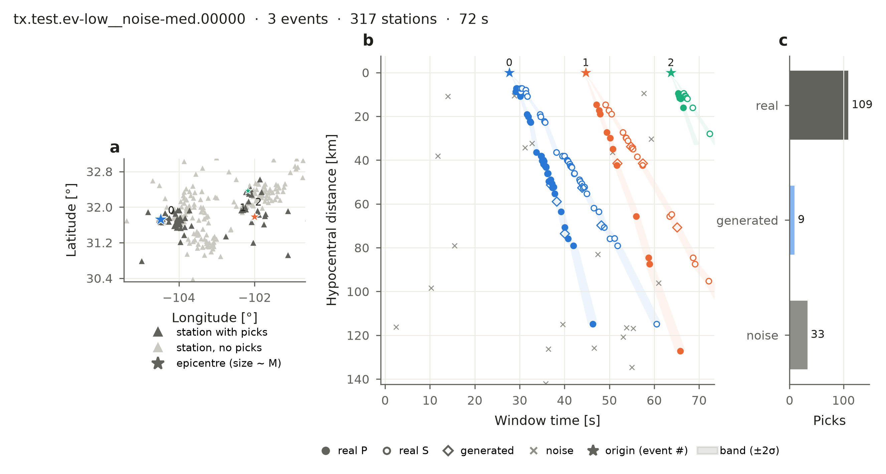

# BEPAD — Benchmark Earthquake Phase Association Dataset

[](https://pypi.org/project/bepad/) [](https://huggingface.co/datasets/ecastillot/BEPAD/tree/main/v0.2) [](https://bepad.readthedocs.io/en/latest/) [](https://github.com/ecastillot/BEPAD)

Thousands of phase-association problems built from **real earthquakes and real picks** of
[UTDQuake](https://huggingface.co/datasets/ecastillot/UTDQuake). Each **window** holds several
overlapping earthquakes on one seismic network, with real, generated and noise picks, and the
answer (earthquake) for every pick.



*One window (Texas network): (a) earthquakes and stations, (b) every pick at its distance from
its earthquake, (c) picks by type. The associator's job is to find which picks belong together.*

**v0.2** (current) is built from UTDQuake 1.0 (Hugging Face commit `8524c6f0`): every seismic network, named by
its UTDQuake code (`tx`, `CM`, `R08` ...). A station is `NET.STA` (FDSN network and station code).

## Quick start

```python
import bepad                                   # pip install bepad
test = bepad.load("test", networks=["tx"], max_windows=20, labels=False)   # 20 Texas test windows
for w in test:
    w.picks, w.stations                        # the inputs of one association problem
report = bepad.evaluate(predictions, test)     # score your associator
```

Without the package:

```python
import pandas as pd
picks = pd.read_parquet("hf://datasets/ecastillot/BEPAD/v0.2/test/picks/network=tx.parquet")
```

## Content

| Folder | What |
|---|---|
| `v0.2/<split>/windows` | one row per window: network, scenario (which earthquakes, how many, noise), counts, difficulty, seed |
| `v0.2/<split>/events` | the earthquakes of each window (origin, location, magnitude, sequence and role) |
| `v0.2/stations.parquet` | station coordinates; `station` = `NET.STA`, `network` = UTDQuake network |
| `v0.2/<split>/window_stations` | the stations available in each window (`window_id`, `station`); coordinates in `stations.parquet` |
| `v0.2/<split>/picks` | one row per pick: station, phase, time; labels `event_idx` (−1 noise), `pick_type` (real / generated / noise), `real`, `prob` (optional confidence for training, from detectability) |
| `v0.2/metadata/` | window statistics as CSV |
| `v0.2/label_model.json` | predicted arrivals, timing uncertainty and `prob` model |
| `v0.1/` | the previous release (23 scenarios, no sequences), same layout |
| `pool/` | the quality-controlled earthquakes and picks (for generating new training windows) |
| `associators/<name>/` | contributed associators (code + parameters), runnable with `bepad run` |
| `leaderboard/` | submitted results (scores + predictions) and the tables in `leaderboard/README.md` |

Per network and scenario: 600 train, 120 val and 60 test windows; 38 scenarios: which earthquakes
(at random, a **sequence** of aftershocks and foreshocks, or outside the network) × how many (1–20)
× how much noise ([Scenarios](https://bepad.readthedocs.io/en/latest/scenarios.html)). Every earthquake in a window has
≥ 4 real P picks on ≥ 3 stations inside it.

| Split | Windows | Networks |
|---|---|---|
| train | 2,050,470 | 90 |
| val | 408,876 | 90 |
| test | 207,197 | 91 |

Networks with fewer than 200 earthquakes are test only (ESPOO, `R06`).

## BEPAD-10

The main ranking uses the **BEPAD-10 test**: the test windows of 10 networks chosen for different
scales, geometries and depths, from a 4 km fracking array to national networks:
`R05` ToC2ME, `R07` LASSO, `R01` COSEISMIQ, `nc` N. California, `tx` Texas, `JMA` Japan,
`CM` Colombia, `R09` N. Chile (IPOC), `ak` Alaska, `NOA` Greece. Every leaderboard entry must run them:

```bash
bepad run associators/my-method --split test --networks core --out results/my-method
bepad submit results/my-method --code associators/my-method --dry-run    # your row, nothing is sent
```

## Leaderboard

See `leaderboard/README.md`: the BEPAD-10 table first (mean over its networks), then all networks,
then one table per network. To add a method: `bepad new`, `bepad run`, `bepad submit` — the last
command opens a pull request on this repository that adds only your two folders.

## Benchmark rules

1. Report on the `test` split. 2. Use only `picks` (without label columns) and stations as input.
3. Treat each window separately. 4. Tune only on `train` / `val`; velocity models must be published or fitted on `train` / `val`.
5. Run at least the BEPAD-10 networks. 6. Submit your code with your results (`bepad submit --code`): the test labels are public, so
entries are re-run before they are merged.

## License and citation

Data follow the terms of the original providers as distributed by UTDQuake; please cite UTDQuake
and the network operators. Code (the `bepad` package): GPL-3.0.
